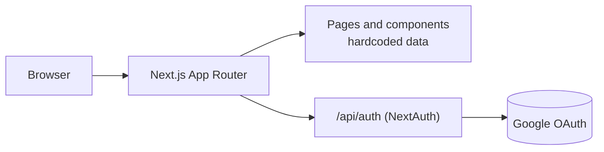
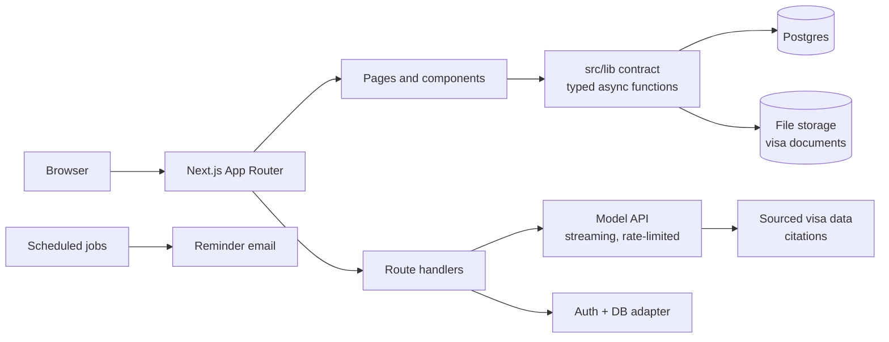

# GlobalLife AI

**One place to plan a move abroad: which visa fits you, what it needs, and the language level
it asks for — with a plan to reach that level in time.**

[](https://github.com/Tunaycel/Global-Life-Ai/actions/workflows/ci.yml)
[](LICENSE)
[](https://github.com/Tunaycel/Global-Life-Ai/milestone/1)
[](https://github.com/Tunaycel/Global-Life-Ai/issues)
[](https://github.com/Tunaycel/Global-Life-Ai/pulls)

Next.js 16 · React 19 · TypeScript 5.9 · NextAuth · Three.js · Tailwind 4 · Zustand

> **Status: front-end complete, back-end in progress.** Google sign-in is real. Visa, lesson and
> assistant screens still render designed states from hardcoded data; the database, APIs and the
> AI assistant are being built in [milestones M1–M5](#roadmap). Nothing on this page claims
> more than that.

---

## Contents

[Why](#why) · [Codebase at a glance](#codebase-at-a-glance) · [What works today](#what-works-today) ·
[Architecture](#architecture) · [Roadmap](#roadmap) · [Engineering process](#engineering-process) ·
[Quality gates](#quality-gates) · [Getting started](#getting-started) · [Team](#team)

## Why

Relocation tools are split in two. Visa platforms (Boundless, Alma, Deel, Atlys) do not teach
the language; language apps (Speak, Praktika, Duolingo) do not know what the visa requires.
Many routes have a language condition — a spouse visa, a job-seeker card, a university place.
GlobalLife starts from the target visa and works backwards to the language plan.

Every visa rule, fee or duration shown to a user carries a link to its official source and the
date it was last checked. A rule without a source is not shown.

## Codebase at a glance

Measured in October 2026, with the contribution setup (#1) and the test setup (#40) in place.

| Metric | Value |
|---|---|
| TypeScript / TSX in `src/` | 7,125 lines (14 of them tests) |
| Routes (`page.tsx`) | 18 |
| React components | 27 |
| Locales | 4 (TR, EN, DE, PL) — one dictionary in `src/lib/i18n.ts`, falls back to English; most screens not wired yet ([#8](https://github.com/Tunaycel/Global-Life-Ai/issues/8)) |
| API routes | 1 (NextAuth) |
| Runtime / dev dependencies | 20 / 11 |
| Automated tests | 3 — 2 unit tests (Vitest) and 1 smoke test of the production build (Playwright) |
| Lint | 15 errors, 46 warnings — tracked in [#2](https://github.com/Tunaycel/Global-Life-Ai/issues/2) |
| CI | typecheck, unit tests, production build and smoke test on every PR |

## What works today

| Area | State | Tracking |
|---|---|---|
| Google sign-in, session with stable user id | **Working** | — |
| Dashboard route guard | Missing | [#4](https://github.com/Tunaycel/Global-Life-Ai/issues/4) |
| Landing, dashboard, 3D scenes, transitions, responsive layout | **Working** (static content) | [#3](https://github.com/Tunaycel/Global-Life-Ai/issues/3) removes unverifiable claims |
| Visa guide, roadmap, documents | Designed, hardcoded data | [M2](https://github.com/Tunaycel/Global-Life-Ai/milestone/2) |
| AI assistant (three chat UIs) | Scripted replies, no model call | [M3](https://github.com/Tunaycel/Global-Life-Ai/milestone/3) |
| Lessons, IELTS practice, progress, stats | Designed, hardcoded data | [M4](https://github.com/Tunaycel/Global-Life-Ai/milestone/4) |
| Database, storage, reminders | Not started | [#20](https://github.com/Tunaycel/Global-Life-Ai/issues/20), [#23](https://github.com/Tunaycel/Global-Life-Ai/issues/23), [#28](https://github.com/Tunaycel/Global-Life-Ai/issues/28) |

## Architecture

**Today**



**Target** — screens never talk to the database directly. They call typed functions in `src/lib/`
(the data-layer contract, [ADR 0003](docs/adr/0003-data-layer-contract.md)); those return mock
data first and real data once the back end is wired, without screen changes.



Key decisions are recorded as ADRs in [`docs/adr`](docs/adr).

## Roadmap

| Milestone | Scope | Progress |
|---|---|---|
| [M1 Foundation](https://github.com/Tunaycel/Global-Life-Ai/milestone/1) | lint, auth guard, data contract, database, tests |  |
| [M2 Visa core](https://github.com/Tunaycel/Global-Life-Ai/milestone/2) | eligibility engine, sourced data for DE / PL / NL, roadmap, documents |  |
| [M3 AI assistant](https://github.com/Tunaycel/Global-Life-Ai/milestone/3) | one assistant, real model, answers cite sources |  |
| [M4 Language](https://github.com/Tunaycel/Global-Life-Ai/milestone/4) | lessons, progress, speaking and IELTS practice |  |
| [M5 Quality and launch](https://github.com/Tunaycel/Global-Life-Ai/milestone/5) | i18n, accessibility, performance, monitoring, privacy |  |

## Engineering process

```
Issue → branch → PR (auto-merge on) → CI + Task gate + CodeRabbit
      → lead approves → merged → issue closes
```

- **Every change starts as an issue** with acceptance criteria ([templates](.github/ISSUE_TEMPLATE)).
- **One issue, one branch, one PR.** Branches are `<user>/<issue>-<short-name>`.
- **Before pushing:** typecheck, lint, tests and build; ask for a review on bigger changes.
- **Design first for anything non-trivial:** a short [design doc](docs/templates/design-doc.md);
  lasting decisions become an [ADR](docs/templates/adr.md).
- **Incidents** get a blameless [postmortem](docs/templates/postmortem.md); releases follow the
  [release checklist](docs/templates/release-checklist.md) and land in the [changelog](CHANGELOG.md).

The full workflow is in [CONTRIBUTING.md](CONTRIBUTING.md).

## Quality gates

Enforced by GitHub on `master` ([rulesets as code](.github/rulesets); kept light on purpose, [ADR 0004](docs/adr/0004-simplify-the-workflow.md)):

| Gate | Applies to |
|---|---|
| No direct or force pushes, branch cannot be deleted | everyone, including the owner |
| Pull request required, squash merge only | everyone |
| CI `Typecheck and build` and `Task gate` (PR closes an issue assigned to its author) | everyone |
| Code-owner approval on the latest push | every PR the owner did not open |
| CodeRabbit review | advisory, every PR |

Approved PRs merge themselves through auto-merge.

## Getting started

Requirements: Node.js 20.9+ (CI uses 24), npm.

```bash
git clone https://github.com/Tunaycel/Global-Life-Ai
cd Global-Life-Ai
npm install
```

`.env.local`:

```
GOOGLE_CLIENT_ID=
GOOGLE_CLIENT_SECRET=
NEXTAUTH_SECRET=      # openssl rand -base64 32
NEXTAUTH_URL=http://localhost:3000
```

Google credentials come from a Google Cloud OAuth client with
`http://localhost:3000/api/auth/callback/google` as an authorised redirect URI.

| Command | What it does |
|---|---|
| `npm run dev` | dev server on http://localhost:3000 |
| `npx tsc --noEmit` | typecheck |
| `npm run lint` | ESLint |
| `npm run build` | production build |
| `npm test` | unit tests (Vitest), `*.test.ts` next to the code in `src/` |
| `npm run build && npm run test:e2e` | smoke test of the production build (Playwright), `e2e/` |

The first Playwright run needs a browser: `npx playwright install chromium`. CI runs both in the
`Typecheck and build` job.

## Team

| | Role | Owns |
|---|---|---|
| [@Tunaycel](https://github.com/Tunaycel) | Team lead | back end, database, cloud, reviews and merges |
| [@ardasemihyy](https://github.com/ardasemihyy) | Engineer | front end, data-layer contract, eligibility engine, i18n, accessibility |
| [@egezamb](https://github.com/egezamb) | Engineer | infrastructure and tests |

## Security and license

Report vulnerabilities privately — see [SECURITY.md](SECURITY.md).
Released under the [MIT License](LICENSE).
